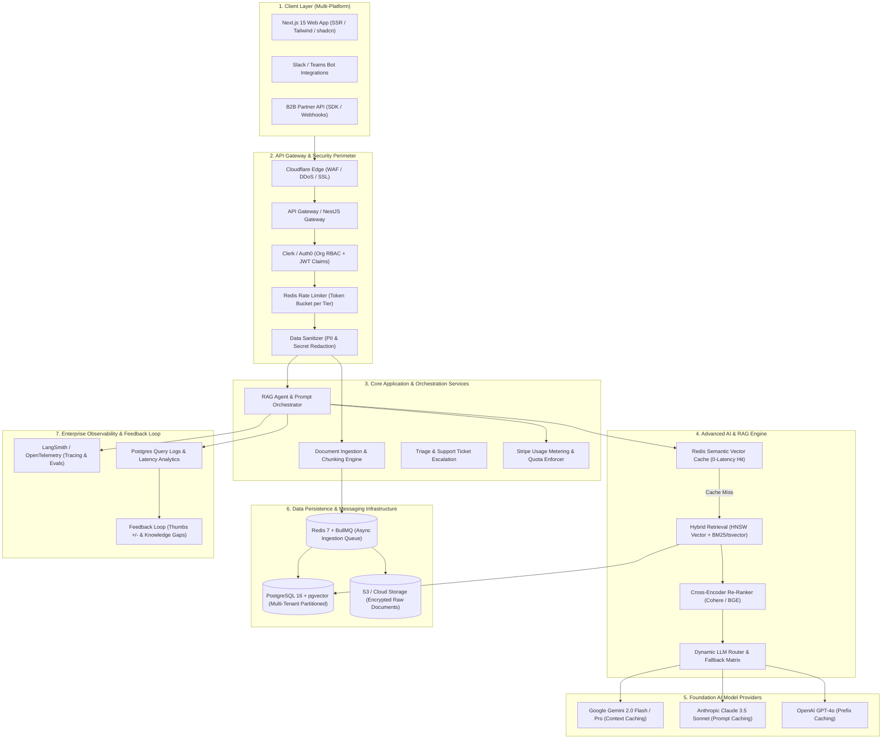

# Production-Grade AI SaaS Architecture Blueprint (လုပ်ငန်းသုံး AI SaaS စနစ် တည်ဆောက်မှု ဗိသုကာ)

> **Role:** Principal AI Architect & Chief Systems Engineer  
> **Domain:** Multi-Tenant B2B AI SaaS, Hybrid RAG, Prompt Engineering & Observability  
> **Target Audience:** Technical Founders, Staff Engineers, Enterprise Architects  

---

## 1. High-Level System Architecture (စနစ်တစ်ခုလုံး၏ ကဏ္ဍစုံ ဗိသုကာ)



---

## 2. Multi-Tenant SaaS Foundation (အဖွဲ့အစည်းအလိုက် သီးသန့်ခွဲခြားမှု မူဘောင်)

Production-grade B2B SaaS အက်ပ်တစ်ခုတွင် Multi-Tenancy လုံခြုံရေးသည် နံပါတ်တစ် အရေးကြီးဆုံး ဖြစ်သည်။

### ၂.၁ Tenancy Isolation Models နှိုင်းယှဉ်ချက်
1. **Pooled / Logical Partitioning (Recommended for most B2B AI SaaS):**
   - ဇယားတိုင်းတွင် `organizationId` ပါဝင်ပြီး PostgreSQL Row-Level Security (RLS) သို့မဟုတ် Prisma tenant-scoping middleware ဖြင့် ခွဲခြားသည်။
   - **အားသာချက်:** ကုန်ကျစရိတ် အနည်းဆုံး၊ Database connection pool စီမံရ လွယ်ကူ၊ Scaling ပြုလုပ်ရ လွယ်ကူသည်။
2. **Schema-per-Tenant:** Tenant တစ်ခုစီအတွက် PostgreSQL Schema တစ်ခုစီ ခွဲထုတ်သည်။ Migration စီမံရ ခက်ခဲပြီး Database connection များပြားသည်။
3. **Database-per-Tenant (Isolated DB):** Enterprise Tier ကြီးများ (ဘဏ်၊ ဆေးရုံ၊ အစိုးရ) အတွက်သာ သီးသန့် Cloud DB instance ပေးသည်။

### ၂.၂ Row-Level & Query-Level Boundary Enforcement
```typescript
// Strict Tenant-Scoped Prisma Extension Example
export const tenantPrisma = (tenantOrgId: string) =>
  prisma.$extends({
    query: {
      $allModels: {
        async $allOperations({ model, operation, args, query }) {
          // Enforce organizationId on all find, create, update, delete
          if (['findMany', 'findFirst', 'count', 'deleteMany', 'updateMany'].includes(operation)) {
            args.where = { ...args.where, organizationId: tenantOrgId };
          }
          return query(args);
        },
      },
    },
  });
```

---

## 3. Prompt Architecture & LLM Engineering (`/prompt-architect` Core)

Production AI အက်ပ်တစ်ခု၏ အဓိက ကုန်ကျစရိတ်နှင့် ကြာချိန် (Latency) သည် Prompt Design အပေါ်တွင် တည်ရှိသည်။

### ၃.၁ Prompt Caching Hierarchy (၈၀% Token စရိတ် သက်သာစေသော နည်းလမ်း)
Google Gemini (Context Caching)၊ Anthropic Claude (Prompt Caching) နှင့် OpenAI (Automatic Prefix Caching) တို့သည် Prompt ၏ ထိပ်ဆုံးရှိ မပြောင်းလဲသော စာသားများ (Static Instructions) ကို Cache ပြုလုပ်ပေးကြသည်။

```
┌────────────────────────────────────────────────────────┐
│  STATIC INSTRUCTIONS (Cache Hits: 80-90% Discount)      │
│  • <system_identity>                                   │
│  • <strict_operating_rules> (Grounding, Tone, Rules)   │
│  • <json_response_schema>                              │
│  • <few_shot_examples> (Positive, Negative, Edge cases)│
├────────────────────────────────────────────────────────┤
│  DYNAMIC CONTEXT (Cache Miss - Paid Token Area)        │
│  • <knowledge_base_context> (Retrieved Chunks [1..k])   │
│  • <conversation_history> (Previous User/Assistant turns)│
│  • <user_query> (Current Ingestion Message)            │
└────────────────────────────────────────────────────────┘
```

> [!IMPORTANT]
> Dynamic Context (ဥပမာ Timestamp သို့မဟုတ် User Name) များကို Prompt ၏ ထိပ်ဆုံးတွင် ဘယ်တော့မှ မထည့်ရပါ။ ထိပ်ဆုံးတွင် ထည့်လိုက်ပါက Cache Key ပြောင်းလဲသွားပြီး Provider Cache Hit မရရှိတော့ဘဲ Token စရိတ် အဆမတန် မြင့်တက်သွားပါမည်။

### ၃.၂ Strict XML Tagging & Deterministic Structured Output
Unstructured text parsing (Regex) အစား strict XML boundaries နှင့် Zod schema validation ကို သုံးစွဲရပါမည်:

```typescript
import { z } from 'zod';

export const AgentAnswerSchema = z.object({
  answer: z.string().describe('The grounded response text in user language with citations'),
  citations: z.array(
    z.object({
      sourceId: z.string(),
      documentTitle: z.string(),
      chunkId: z.string(),
      exactQuote: z.string(),
    })
  ),
  confidenceScore: z.number().min(0).max(1),
  requiresHumanEscalation: z.boolean(),
  escalationDepartment: z.enum(['HR', 'IT', 'SECURITY', 'FINANCE', 'NONE']),
});
```

### ၃.၃ Adversarial Defense-in-Depth (လုံခြုံရေး အကာအကွယ်လွှာများ)
1. **Untrusted Data Isolation:**
   - User inquiry နှင့် Document chunks များကို XML tags (`<user_query>`, `<knowledge_base_context>`) အတွင်း၌သာ ထည့်သွင်းပြီး စနစ်စည်းကမ်း အဖြစ် ဘယ်တော့မှ အသိအမှတ်မပြုရန် စည်းကမ်းသတ်မှတ်သည်။
2. **Canary Leak Token Check:**
   - Model ၏ Output တွင် System Prompt tag များ (ဥပမာ `<strict_operating_rules>`) ပါလာပါက ချက်ချင်း Redact လုပ်ပြီး Alert ထုတ်ပေးသည့် Canary Filter ပါဝင်ရမည်။
3. **Safe Refusal & Graceful Escalation:**
   - မှတ်တမ်းထဲ မပါသော အကြောင်းအရာများအား လျှောက်မဖြေစေဘဲ စနစ်တကျ ငြင်းပယ်ကာ Support Ticket ဖွင့်ပေးရန် လမ်းညွှန်ချက် (Few-Shot Exemplar) ထည့်သွင်းရမည်။

---

## 4. Advanced Hybrid RAG Pipeline (အဆင့်မြင့် ရှာဖွေရေးနှင့် တိကျမှု အင်ဂျင်)

ပုံမှန် Vector Search သာမက Production-Grade Retrieval အဆင့် (၄) ဆင့်:

```mermaid
flowchart LR
    Q["User Query"] --> SC["1. Redis Semantic Cache"]
    SC -->|Hit (Sim >= 0.96)| Instant["0-Cost Instant Response"]
    SC -->|Miss| HS["2. Hybrid Search"]
    
    subgraph HS["Hybrid Retrieval (RRF Fusion)"]
        Dense["Dense Vector (HNSW Cosine)"]
        Sparse["Sparse Lexical (tsvector / BM25)"]
    end
    
    HS --> Top50["Top-50 Candidates"]
    Top50 --> RR["3. Cross-Encoder Re-Ranker"]
    RR --> Top4["Top-4 High-Relevance Chunks"]
    Top4 --> LLM["4. LLM Grounded Generation"]
```

1. **Layer 1: Redis Semantic Cache:**
   - ထပ်ခါတလဲလဲ မေးလေ့ရှိသော မေးခွန်းများ (ဥပမာ "ရုံး Wi-Fi password က ဘာလဲ?", "Annual leave policy") အတွက် Vector Similarity $\ge 0.96$ ရှိပါက LLM သို့ မခေါ်တော့ဘဲ မီလီစက္ကန့်ပိုင်းအတွင်း အခမဲ့ ပြန်လည်ဖြေကြားသည်။
2. **Layer 2: Hybrid Search (RRF - Reciprocal Rank Fusion):**
   - Keyword Matching (`tsvector`) နှင့် Semantic Vector Search (`pgvector`) ရလဒ် ၂ ခုကို ပေါင်းစပ်ပြီး $RRF\_Score(d) = \sum_{m \in M} \frac{1}{60 + r_m(d)}$ ဖြင့် စီစစ်သည်။
3. **Layer 3: Cross-Encoder Re-Ranking:**
   - သာမန် Bi-Encoder ထက် ဆယ်ဆ ပိုမိုတိကျသော Cross-Encoder (Cohere Rerank သို့မဟုတ် BGE-Reranker) ဖြင့် Top-50 မှ အကိုက်ညီဆုံး Top-4 chunks ကိုသာ ရွေးချယ်ပြီး LLM ထံသို့ ပေးပို့သည်။
4. **Layer 4: Linguistic Unicode Boundary Chunking:**
   - ဘာသာစကားအလိုက် (English စာကြောင်းဆုံး `.` နှင့် မြန်မာစာ ပုဒ်မ `။` / ပုဒ်ဖြတ် `၊`) ဝါကျဖွဲ့ထုံး မပျက်စေဘဲ Chunking ပြုလုပ်ခြင်း။

---

## 5. Asynchronous Ingestion & Resilient Queue Architecture

ကြီးမားသော စာရွက်စာတမ်းများ (PDF, Word, Notion, Slack) ကို Web API Thread ထဲတွင် မလုပ်ဆောင်ရပါ။

* **BullMQ & Redis Workers:**
  - Ingestion Job များကို Queue ထဲသို့ ထည့်သွင်းပြီး သီးခြား Background Worker Container များက တာဝန်ယူသည်။
  - File Upload $\to$ Text Extraction $\to$ Data Sanitizer (PII Masking) $\to$ Sentence Chunking $\to$ Batch Embedding (Gemini) $\to$ PostgreSQL Bulk Insert $\to$ Ingestion Status Update.
* **Circuit Breakers & Multi-Model Fallback:**
  - Primary Provider (Gemini 2.0 Flash) Rate limit သို့မဟုတ် Timeout ဖြစ်ပါက Secondary Provider (Claude 3.5 Sonnet / OpenAI GPT-4o) သို့ အလိုအလျောက် Failover ပြုလုပ်သည်။

---

## 6. Billing, Metering & Observability Flywheel (စီးပွားရေးနှင့် စနစ်စောင့်ကြည့်မှု)

B2B SaaS အနေဖြင့် ရေရှည်ရပ်တည်ရန်အတွက်:

1. **Usage Metering per Tenant:**
   - မေးခွန်းတိုင်းအတွက် `promptTokens`၊ `completionTokens`၊ `latencyMs` နှင့် `modelProvider` ကို `query_logs` ဇယားတွင် တိကျစွာ မှတ်သားပြီး Stripe Usage-based billing နှင့် ချိတ်ဆက်သည်။
2. **Unresolved Knowledge Gap Triage:**
   - Assistant အနေဖြင့် ရှာမတွေ့သော မေးခွန်းများကို `isUnresolved = true` အဖြစ် အလိုအလျောက် သတ်မှတ်ပြီး Admin များအတွက် Knowledge Gap Dashboard တွင် ပြသပေးကာ Document အသစ် ဖြည့်သွင်းရန် လမ်းညွှန်ပေးသည်။
3. **Feedback Flywheel:**
   - ဝန်ထမ်းများ၏ Thumbs Up 👍 / Down 👎 rating များကို တိုက်ရိုက်ရယူပြီး Prompt Tuning နှင့် RAG evaluation metrics တွက်ချက်သည်။

---

## 7. Recommended Production Tech Stack Matrix

| အလွှာ (Layer) | အကြံပြုနည်းပညာ (Recommended Stack) | အသုံးပြုရသည့် အကြောင်းရင်း (Why) |
| :--- | :--- | :--- |
| **Frontend Framework** | **Next.js 15 (App Router, React 19)** | SSR, Server Components, Streaming UI (SSE), Vercel AI SDK |
| **Backend & API** | **NestJS (TypeScript)** | Enterprise Dependency Injection, Modular architecture, OpenAPI |
| **Database & Vector** | **PostgreSQL 16 + pgvector** | Relational integrity, ACID transactions, HNSW index for vectors |
| **ORM & Migrations** | **Prisma 7 (Driver Adapters)** | Type-safe queries, composite indexes, automatic schema migration |
| **In-Memory & Cache** | **Redis 7 + Upstash** | Semantic caching, rate-limiting, BullMQ background job queue |
| **Authentication** | **Clerk Auth / Auth0** | Multi-tenant B2B Organizations, RBAC roles, MFA, SSO |
| **AI Orchestration** | **LangChain.js / Vercel AI SDK** | Unified model abstraction, tool calling, token streaming |
| **Foundation Models** | **Gemini 2.0 Flash + Claude 3.5 + GPT-4o** | Best cost-to-intelligence ratio, context caching, multi-model fallback |
| **Observability** | **LangSmith + OpenTelemetry** | Token analytics, latency tracing, regression evaluations |
